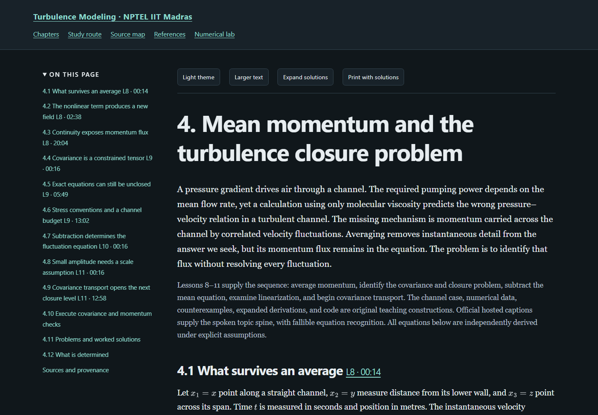

# Turbulence Modeling — independent study edition

Substantial original textbook notes following Prof. Vagesh D.
Narasimhamurthy's NPTEL course at IIT Madras.

[Read the online textbook](https://az9713.github.io/nptel-turbulence-modeling-notes/)
· [Repository](https://github.com/az9713/nptel-turbulence-modeling-notes)

The edition contains 25 chapters covering all 74 numbered lessons and the two
substantive live sessions, with the introduction developed in the study route.
Exact scientific acceptance and release status are recorded in
[the editorial record](editorial-review-summary.json) and
[the completion record](completion.json). Publication is complete only when the
served completion and publication records pass the documented final checks.

- [Open the offline reader](index.html)
- [Read the study route](book-overview.html)
- [Read mean momentum and closure](chapter-04-mean-momentum-and-closure.html)
- [Inspect source coverage](source-map.html)
- [Run the numerical example](code/ch04_closure.py)
- [Read the workflow and evidence limits](WORKFLOW.md)

The playlist contains 77 items: 74 numbered lessons, two extra live sessions,
and a 535-second course introduction. Original playlist positions are retained.
The numbered lessons follow the verified official outline rather than upload
order. Every item remains in the manifest with an explicit current disposition.

The chapters develop turbulent motion, statistical sampling,
conservation, RANS, exact covariance transport, pressure redistribution,
mean/fluctuation energy, inner and outer boundary-layer scaling, eddy viscosity,
two-equation calibration, alternative time scales, near-wall treatment,
realizability, stress transport, DNS, filtering, LES, dynamic modeling, numerical
effects, hybrid interfaces, model choice and numerical verification. Every chapter has
complete worked solutions and an executed program. Original analytic figures
and an interactive numerical lab support the derivations. Review status is
recorded chapter by chapter in the public sidecars and editorial summary.

Open index.html directly in a browser; styles, controls, and mathematical
rendering are bundled for offline use. Python 3.13 is the reference interpreter
for the exact displayed floating-point outputs; examples use no
additional packages. Figure regeneration uses Matplotlib. See requirements.txt
and WORKFLOW.md for validation tools. The [course playlist](https://www.youtube.com/playlist?list=PLyqSpQzTE6M81PXW54uBNXd8-bqSynwiQ)
is recorded in the public source manifest.

The [source evidence](source-validation-summary.json) distinguishes hosted captions
from local machine transcription and records the limitations of both. Lessons
65–66 contain disclosed publisher-caption contamination. Mathematical identities
are derived and checked against the stated primary definitions; comprehensive
video/board inspection, formal proof checking and physical model validation are
not claimed.

Raw captions, recordings, downloaded references, prompts, private review
material, logs, caches, and credentials stay in ignored work/. This edition
does not redistribute the lecture transcripts and is not an official NPTEL
publication.
